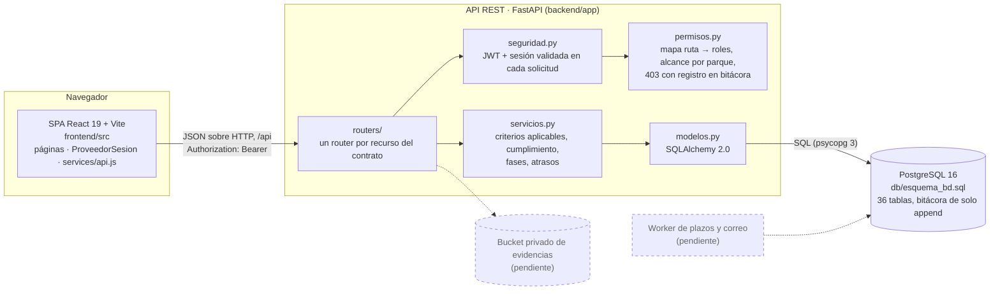
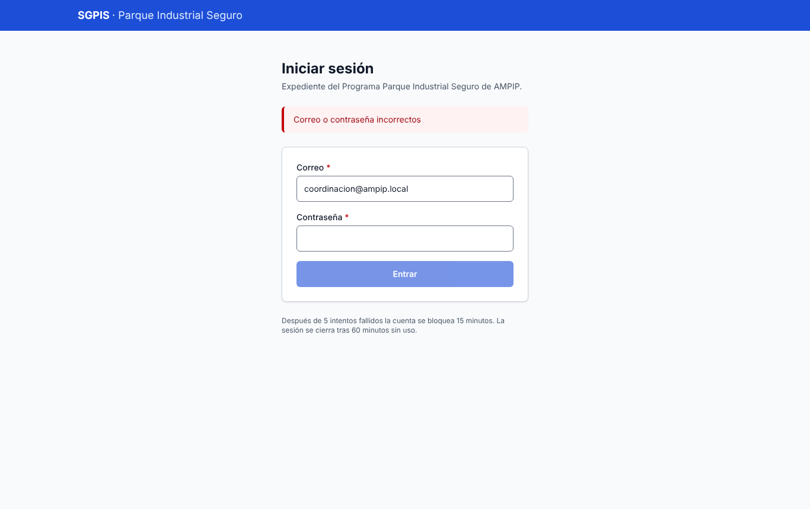
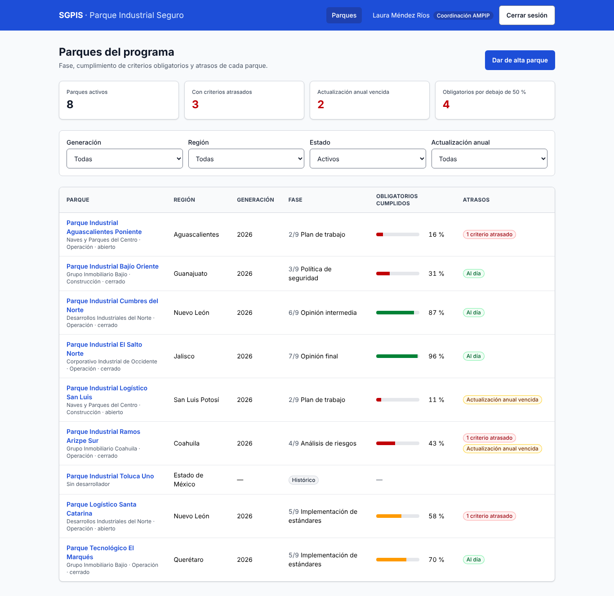
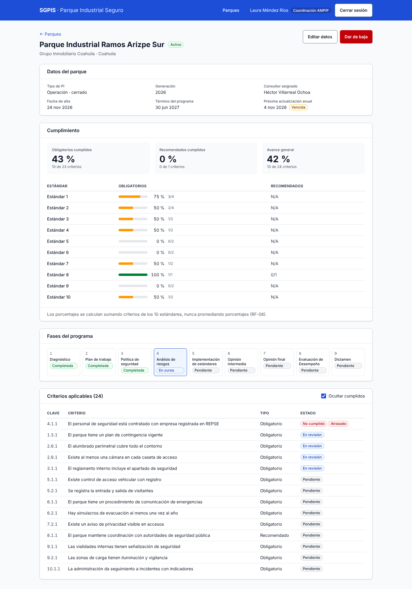
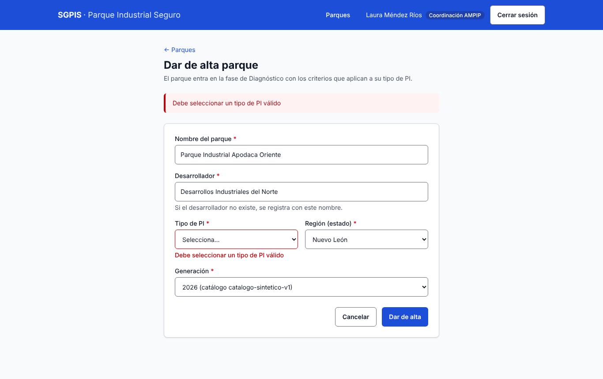
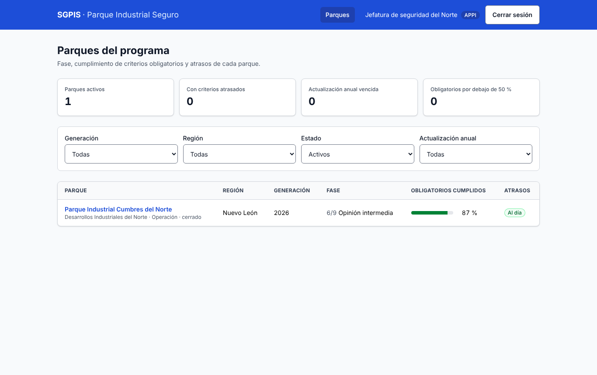

# SGPIS: Sistema de Gestión del Programa Parque Industrial Seguro

Aplicación web para llevar el expediente de cada parque industrial inscrito en el Programa Parque Industrial Seguro de AMPIP (Asociación Mexicana de Parques Industriales Privados).

**Equipo 19 · TC5062 Análisis, diseño y construcción de software · Grupo 10 · Tec de Monterrey**

| Integrante | Rol SCRUM |
|---|---|
| Ángel Sebastián Kociankowski Montelongo | Product Owner, Developer |
| Leonardo Cossío Dinorín | Scrum Master, Developer |
| Erick Noé Ramírez Olvera | Developer |

## Qué problema resuelve

Hoy el programa se lleva con hojas de cálculo y correos. Cada parque recibe un checklist de 286 criterios en diez estándares de seguridad. La APPI (la administración del parque) junta evidencias, el consultor asignado las revisa y Coordinación AMPIP necesita saber cómo va cada parque para llevarlo a comité. Las versiones del checklist se cruzan por correo, nadie tiene a la vista cuál parque está atrasado y el porcentaje de cumplimiento se recalcula a mano. Además, los documentos de seguridad de un parque (análisis de riesgos, ubicación de cámaras, controles de acceso) no deberían verlos los otros parques ni el personal administrativo.

SGPIS concentra eso en un solo expediente por parque:

- Coordinación AMPIP ve en un tablero todos los parques de la generación, en qué fase del programa va cada uno, su porcentaje de criterios obligatorios cumplidos y quién tiene atrasos.
- El cumplimiento se calcula solo, separando obligatorios de recomendados y sumando criterios (no promediando porcentajes), y solo con los criterios que aplican al tipo de parque.
- Cada rol ve lo suyo: la APPI solo su parque, el consultor solo sus parques asignados y el gerente corporativo solo los de su desarrollador. La API impone la regla en cada solicitud, y todo intento negado queda en la bitácora.

El alcance completo está en [`S03_A1/SRS_equipo.md`](S03_A1/SRS_equipo.md) (39 RF) y lo que está hecho de ese alcance, en [`S11_A1/matriz_trazabilidad.md`](S11_A1/matriz_trazabilidad.md).

## Estado al cierre del semestre

| | |
|---|---|
| Requerimientos funcionales | 12 completos, 10 parciales, 17 sin implementar (65 de 150 criterios de aceptación) |
| API | 51 de las 91 operaciones del contrato [`openapi_equipo.yaml`](S05_S06_A1/openapi_equipo.yaml) |
| Pruebas del backend | 105 automatizadas, todas pasan |
| Frontend | Login, tablero de parques, expediente del parque, alta, edición y baja de parque |
| Pendiente principal | Evidencias y calificación de criterios (RF-05, RF-27) y todo lo que depende de ellas: Opinión, comité y dictamen |

La retrospectiva, con lo que salió bien y lo que no, está en [`S11_A1/retrospectiva_proyecto.md`](S11_A1/retrospectiva_proyecto.md).

## Arquitectura

Cliente-servidor (ADR de S04, ajustado en [`S05_S06_A1/arquitectura_equipo.md`](S05_S06_A1/arquitectura_equipo.md)). Una SPA en React consume una API REST. El backend es un monolito modular en capas y es el único lugar donde se decide un permiso; el frontend muestra lo que la API le entrega.



| Componente | Qué hace |
|---|---|
| `frontend/` | SPA en React. `services/api.js` es el único punto de salida al backend: agrega el token y convierte cualquier error (respuesta de la API o red caída) en `{codigo, mensaje, detalles}`. `sesion/ProveedorSesion.jsx` guarda la sesión con Context API y regresa al login cuando la API responde 401. |
| `backend/app/routers/` | Un router por grupo de recursos del contrato: autenticación, catálogo, generaciones, parques, usuarios, asignaciones, criterios del parque, autoevaluación, cumplimiento, plan de trabajo, análisis de riesgos, fases, configuración, bitácora, historial. |
| `backend/app/seguridad.py` | Contraseñas con bcrypt y JWT HS256. El token lleva un `sid` que se busca en la tabla `sesion` en cada solicitud, para que el logout y los 60 minutos de inactividad lo invaliden antes de su `exp` (RF-26). |
| `backend/app/permisos.py` | Mapa `(método, ruta) → perfiles` y reglas por parque (APPI del parque, consultor asignado, gerente del desarrollador). Si una ruta protegida no está en el mapa, la API no arranca. |
| `backend/app/servicios.py` | Reglas de negocio compartidas: criterios aplicables por tipo de PI, cálculo de cumplimiento, fases y atrasos. |
| PostgreSQL 16 | Esquema en `backend/db/esquema_bd.sql`, con restricciones `CHECK`, llaves compuestas y un trigger que impide modificar la bitácora (RNF-03). |
| Worker y bucket | Diseñados en S04 y S05-S06 y todavía sin implementar. Por eso los atrasos se calculan al consultar y la carga de evidencias no existe. |

## Stack tecnológico

| Capa | Tecnología | Versión | Para qué |
|---|---|---|---|
| Lenguaje backend | Python | 3.12 | Lenguaje que domina el equipo |
| Framework API | FastAPI | 0.161 | Rutas, validación y OpenAPI generado en `/api/docs` |
| Servidor ASGI | Uvicorn | 0.54 | Servir la API |
| ORM | SQLAlchemy | 2.0.55 | Acceso a datos; el esquema vive en SQL, no se genera desde el ORM |
| Driver | psycopg | 3.3 | Conexión a PostgreSQL |
| Validación | Pydantic | 2.14 | Esquemas de request y response en camelCase |
| Autenticación | PyJWT + bcrypt | 2.15 / 5.0 | Token de sesión y hash de contraseñas |
| Base de datos | PostgreSQL | 16 | Datos relacionales con integridad en la base |
| Dependencias Python | uv | 0.5 o superior | Entorno reproducible con `uv.lock` |
| Contenedores | Docker + Docker Compose | Docker Desktop actual | PostgreSQL y API en desarrollo |
| Frontend | React | 19.3 | Interfaz (JavaScript + JSX, decisión de S07-S08) |
| Ruteo | React Router | 7.18 | Rutas y rutas protegidas |
| Bundler | Vite | 8.3 | Servidor de desarrollo y build |
| Estilos | Tailwind CSS | 4.3 | Estilos con tokens propios en `src/index.css` |
| Linter frontend | oxlint | 1.90 | `npm run lint` |
| Pruebas backend | pytest + openapi-core | 9.1 / 0.23 | Pruebas contra PostgreSQL real, cada respuesta validada contra el contrato |
| Pruebas E2E | Playwright (Python) | 1.63 | Flujos del video en el navegador |
| Calidad | pylint, flake8, mypy, bandit | ver `pyproject.toml` | Análisis estático (S09) |

## Instalación y ejecución local

Los pasos se probaron completos en Linux. En macOS son los mismos; así levantamos el backend desde S05-S06. Necesitas:

- Git
- Docker Desktop (levanta PostgreSQL y la API)
- [uv](https://docs.astral.sh/uv/) (`brew install uv`): instala Python 3.12 por su cuenta
- Node.js 20 o superior (`brew install node`)
- Solo para las pruebas del backend: el cliente `psql` (`brew install libpq && brew link --force libpq`)

### 1. Clonar

```bash
git clone https://github.com/CLA-TC5062-SN2026/Equipo19.git
cd Equipo19
```

### 2. Variables de entorno

```bash
cp backend/.env.example backend/.env
cp frontend/.env.example frontend/.env
```

En `backend/.env` hay que cambiar, como mínimo:

1. `POSTGRES_PASSWORD`, con cualquier valor. Pon el mismo valor dentro de `DATABASE_URL`.
2. `JWT_SECRET`, con la salida de `python3 -c "import secrets; print(secrets.token_urlsafe(48))"`. La API rechaza el valor de ejemplo.
3. `SEMILLA_CONTRASENA` y `DEMO_CONTRASENA`: contraseñas de prueba para la cuenta de Coordinación y para las cuentas de demostración.

`frontend/.env` funciona sin cambios si el backend corre en `localhost:8000`. Todas las variables están en la tabla de [Variables de entorno](#variables-de-entorno).

### 3. Backend: base de datos, API y datos de demostración

```bash
cd backend
docker compose up -d --build                  # PostgreSQL 16 + API en http://localhost:8000
curl http://localhost:8000/api/salud          # {"estado":"ok","baseDatos":"ok",...}

uv sync                                       # dependencias de Python (crea backend/.venv)
uv run --env-file .env python -m app.semilla  # catálogo sintético, generación 2027 y cuenta de Coordinación
uv run --env-file .env python -m app.demo_s11 # generación 2026 con 8 parques, consultores, APPI y avance
cd ..
```

El esquema se carga solo la primera vez que arranca el contenedor. Para empezar de cero: `docker compose down -v` y repetir el paso 3.

La documentación interactiva de la API queda en http://localhost:8000/api/docs.

### 4. Frontend

```bash
cd frontend
npm install
npm run dev                                   # http://localhost:5173
```

### 5. Entrar

| Rol | Correo | Contraseña |
|---|---|---|
| Coordinación AMPIP | el de `SEMILLA_CORREO` (por omisión `coordinacion@ampip.local`) | `SEMILLA_CONTRASENA` |
| Consultor | `mariana.trevino@consultores-demo.mx` | `DEMO_CONTRASENA` |
| APPI | `seguridad@cumbres-del-norte.demo.mx` | `DEMO_CONTRASENA` |
| Gerente corporativo | `gerente@dinorte-demo.mx` | `DEMO_CONTRASENA` |

Los parques, desarrolladores y personas del escenario de demostración son inventados. El catálogo es sintético (24 criterios con la misma estructura que el de AMPIP). No hay datos reales del programa en el repositorio.

### Sin Docker para la API

Si prefieres correr la API fuera del contenedor (por ejemplo, para depurar), deja solo la base en Docker:

```bash
cd backend
docker compose up -d db
uv run --env-file .env uvicorn app.main:app --reload --port 8000
```

## Pruebas

### Backend (pytest)

Cada prueba crea una base nueva a partir de `db/esquema_bd.sql` y valida cada respuesta contra `S05_S06_A1/openapi_equipo.yaml`. Por eso necesitan un usuario de PostgreSQL que pueda crear bases y el cliente `psql`. El usuario del contenedor de Docker sirve:

```bash
cd backend
docker compose up -d db
SGPIS_TEST_ADMIN_URL="postgresql://sgpis:<POSTGRES_PASSWORD>@localhost:5432/postgres" uv run pytest
```

Resultado esperado: `105 passed`. Los nombres llevan el criterio de aceptación que verifican (`test_RF_26_AC_3_bloqueo_tras_5_intentos`), y así se cruzan con la matriz de trazabilidad.

Otros comandos útiles:

```bash
uv run pytest tests/test_trazabilidad_s11.py -v   # AC agregados en S11
uv run pytest --cov=app --cov-report=term-missing # cobertura
bash scripts/calidad.sh                           # pylint, flake8, mypy y bandit (S09)
```

### Frontend

```bash
cd frontend
npm run lint      # oxlint, sin advertencias
npm run build     # build de producción en dist/
```

### Punta a punta (Playwright)

Recorre en el navegador los flujos del video: login con error y sin error, tablero, expediente, alta con error de validación, edición, baja, aislamiento de la APPI y servidor caído. Necesita backend y frontend levantados y los datos de `app.demo_s11`. Modifica datos (da de alta y de baja un parque).

```bash
pip install playwright && playwright install chromium
cd frontend
set -a; . ../backend/.env; set +a                 # toma SEMILLA_CORREO, SEMILLA_CONTRASENA y DEMO_CONTRASENA
python e2e/flujos_s11.py                          # termina con "OK"
```

## Variables de entorno

Los valores reales van en `backend/.env` y `frontend/.env`, que están en `.gitignore`.

### Backend (`backend/.env`)

| Variable | Obligatoria | Ejemplo / por omisión | Para qué |
|---|---|---|---|
| `POSTGRES_DB` | No | `sgpis` | Nombre de la base del contenedor |
| `POSTGRES_USER` | No | `sgpis` | Usuario de la base del contenedor |
| `POSTGRES_PASSWORD` | Sí | `<contraseña>` | Contraseña de la base; Docker Compose no arranca sin ella |
| `DATABASE_URL` | Sí, fuera de Docker | `postgresql+psycopg://sgpis:<contraseña>@localhost:5432/sgpis` | Conexión de la API, de la semilla y del escenario demo cuando corren con `uv run`. Dentro de Compose la arma el servicio `api` |
| `JWT_SECRET` | Sí | `<48 caracteres aleatorios>` | Firma de los tokens (mínimo 32 bytes). Sin ella el login responde 500 |
| `JWT_EXPIRATION` | Sí | `28800` | Vida máxima del token en segundos (60 a 86 400). La inactividad de 60 min aplica aparte |
| `URL_SPA` | No | `http://localhost:5173` | Origen del frontend: CORS y enlaces de invitación |
| `CORS_ORIGENES` | No | vacío | Otros orígenes permitidos, separados por coma (por ejemplo, el dominio del frontend desplegado) |
| `INVITACION_VIGENCIA_HORAS` | No | `72` | Vigencia del enlace de invitación (RF-03) |
| `ZONA_HORARIA` | No | `America/Mexico_City` | Zona para fechas y atrasos |
| `SEMILLA_CORREO` | Para la semilla | `coordinacion@ampip.local` | Cuenta de Coordinación que crea `app.semilla` |
| `SEMILLA_CONTRASENA` | Para la semilla | `<contraseña de prueba>` | Su contraseña |
| `SEMILLA_APPI_CONTRASENA` | Para `semilla --demo` | `<contraseña de prueba>` | APPI de las colecciones de Postman de S05-S06 |
| `DEMO_CONTRASENA` | No | `Demo-SGPIS-2026` | Contraseña de las cuentas que crea `app.demo_s11` |

### Pruebas

| Variable | Por omisión | Para qué |
|---|---|---|
| `SGPIS_TEST_ADMIN_URL` | `postgresql://postgres@localhost:5432/postgres` | Usuario de PostgreSQL con permiso de crear bases |
| `SGPIS_CONTRATO` | `S05_S06_A1/openapi_equipo.yaml` | Contrato contra el que se valida cada respuesta |
| `E2E_URL` / `E2E_API` | `http://localhost:5173` / `http://localhost:8000` | Dónde corre la prueba de punta a punta |
| `E2E_CAPTURAS` | vacío | Carpeta donde guardar una captura por paso |

### Frontend (`frontend/.env`)

| Variable | Obligatoria | Por omisión | Para qué |
|---|---|---|---|
| `VITE_API_URL` | No | `http://localhost:8000/api` | URL base de la API. Se fija al compilar (`npm run build`) |

## URL de producción

No hay despliegue en producción. El proyecto corre en local con los pasos de arriba. La Definition of Done de S03 dejó el despliegue fuera porque el equipo no tiene servidor (`S03_A2/definition_of_done.md`, sección 4), y el entregable no lo pedía hasta ahora.

El despliegue que diseñamos está en `S05_S06_A1/arquitectura_equipo.md`: un servidor con Docker Compose detrás de Caddy (HTTPS), PostgreSQL 16 gestionado por el proveedor, el build de `frontend/` servido como archivos estáticos y `CORS_ORIGENES` apuntando al dominio del frontend. El código ya está listo para eso. Faltan el servidor y el bucket de evidencias.

## Capturas

Tomadas con el escenario de `app.demo_s11` por `frontend/e2e/flujos_s11.py`.

Inicio de sesión con contraseña incorrecta. El mensaje es el que fija el SRS (RF-26-AC-2).



Tablero de Coordinación AMPIP. Fase, cumplimiento de obligatorios y atrasos de cada parque de la generación.



Expediente de un parque. Cumplimiento por estándar, nueve fases y criterios pendientes con su atraso.



Alta de parque con error de validación. La API responde 422 y el formulario marca el campo.



Sesión de una APPI. Solo ve su parque y no tiene acciones de Coordinación.



## Estructura del repositorio

| Ruta | Contenido |
|---|---|
| `backend/` | API FastAPI, esquema SQL, pruebas, Docker Compose. Detalle en [`backend/README.md`](backend/README.md) |
| `frontend/` | SPA React, prueba de punta a punta en `e2e/`. Detalle en [`frontend/README.md`](frontend/README.md) |
| `docs/img/` | Capturas de este README |
| `S03_A1/` | SRS de equipo, backlog (22 HU) y priorización |
| `S03_A2/` | Sprint 1: planeación, tareas y Definition of Done |
| `S05_S06_A1/` | Arquitectura de equipo, contrato OpenAPI, esquema de base de datos, colecciones de Postman |
| `S05_S06_A2/` | Autenticación y revisión de seguridad |
| `S07_S08_A1/` | Decisión de stack del frontend, componentes y accesibilidad |
| `S09_A1/` | Análisis estático, code review, refactorizaciones y deuda técnica |
| `S11_A1/` | Matriz de trazabilidad, retrospectiva y video de la demo |
