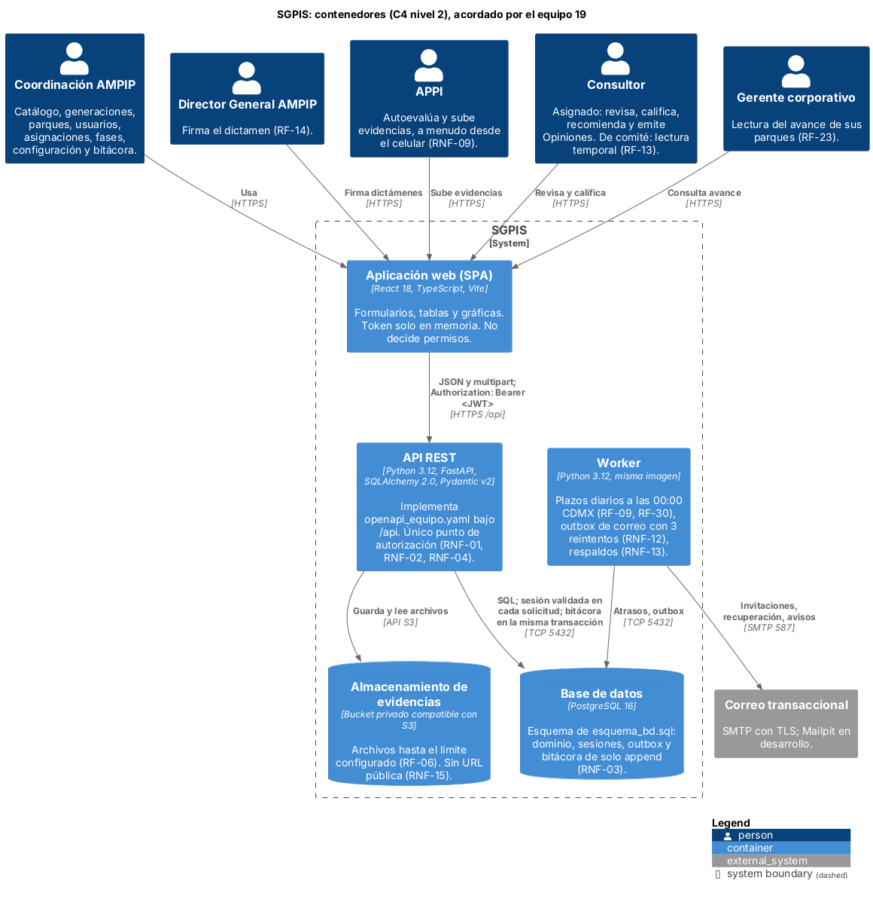
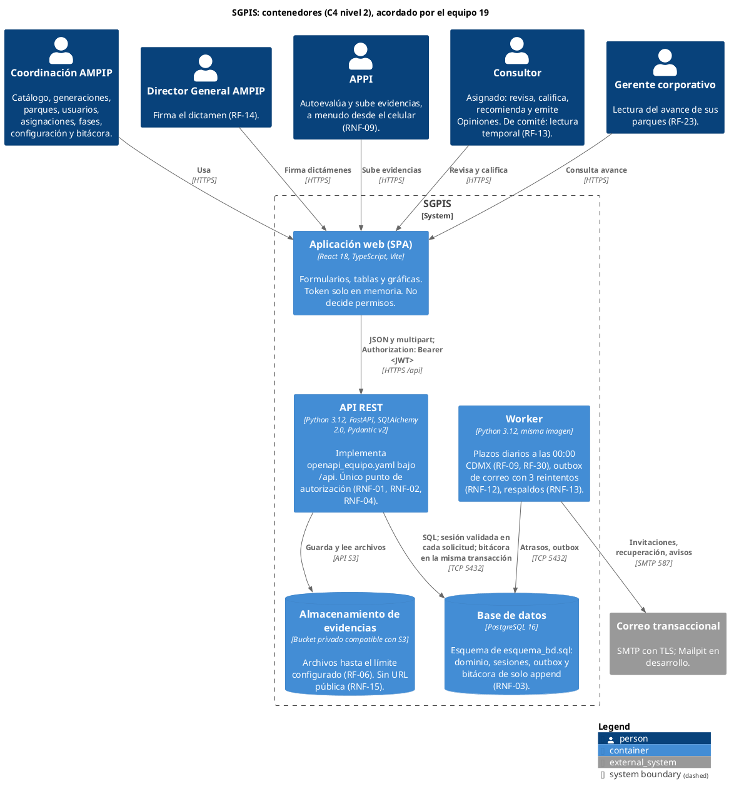
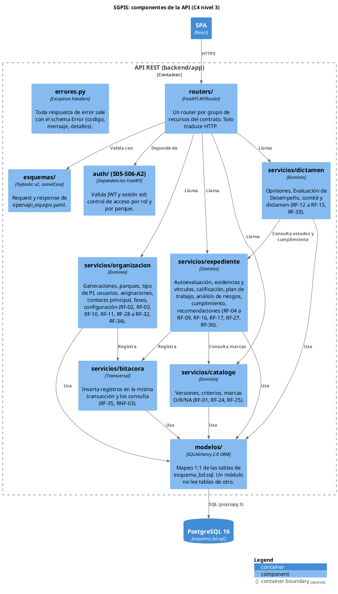

# Arquitectura del equipo: SGPIS

**Equipo:** 19 (Ángel Kociankowski, Leonardo Cossío, Erick Ramírez)
**Actividad:** S05-S06-A1, Parte 0
**Insumos:** `../S03_A1/SRS_equipo.md` v2.0, ADR-001 y diagramas de S04_A1 (Ángel), `../S03_A2/sprint1_planning.md` y `../S03_A2/tareas_tecnicas.md`, `openapi_equipo.yaml`
**Diferencias con los diseños individuales:** `diferencias_diseno.md`, sección 4

## Decisión

Cliente-servidor. Una SPA en React consume una API REST, y el backend es un monolito modular en capas, con un worker aparte para lo que corre fuera de una solicitud.

Partimos del ADR-001 de S04_A1 y lo ajustamos en cuatro puntos:

1. El ADR original suponía un solo desarrollador y ahora somos tres. El argumento contra microservicios sigue en pie, porque descansaba en que RD-09, RF-17 y RNF-01 necesitan una transacción y un solo punto de autorización. Lo que cambia es la regla de fronteras entre módulos: con tres personas trabajando en paralelo es más fácil romperla, así que se revisa en cada PR.
2. El contrato del equipo usa `/api` en lugar de `/api/v1` y agrupa la autenticación en `/auth/register`, `/auth/login`, `/auth/me` y `/auth/logout` (decisión D-01).
3. El JWT lleva `exp` tomado de `JWT_EXPIRATION`, y además la sesión `sid` se valida en cada solicitud para cerrar sesión (RF-26-AC-5) y expirar por inactividad (RF-26-AC-6). Se implementa en S05-S06-A2; en S05-S06-A1 las rutas todavía no exigen token, como pide la actividad.
4. Para desarrollo, `docker compose` levanta PostgreSQL 16 y la API (tarea T-01 del Sprint 1). El esquema se crea con `esquema_bd.sql` al primer arranque del contenedor. Mailpit y el worker entran cuando se implementen correo y revisión de plazos.

## Vista de contenedores (C4 nivel 2)

## Vista de componentes de la API (C4 nivel 3)

## Entorno de desarrollo

| Servicio | Imagen o comando | Puerto | Nota |
|---|---|---|---|
| `db` | `postgres:16-alpine` | 5432 | Monta `backend/db/esquema_bd.sql` en `/docker-entrypoint-initdb.d/`; las tablas se crean al primer arranque. |
| `api` | `uvicorn app.main:app` | 8000 | Lee `DATABASE_URL` y, desde S05-S06-A2, `JWT_SECRET` y `JWT_EXPIRATION` del `.env`. El repo solo trae `.env.example`. |

Producción conserva el despliegue de S04_A1 (`diagrama_despliegue.puml`): un servidor con Docker Compose detrás de Caddy, bucket privado y monitoreo de `/api/salud` cada 5 minutos.

## Reglas que el equipo se compromete a respetar

- El contrato manda. Un endpoint que no está en `openapi_equipo.yaml` no se programa; si hace falta, primero se cambia el contrato en un PR que revisan los otros dos.
- Las tablas salen de `esquema_bd.sql`, y los modelos ORM las reflejan sin agregar columnas por su cuenta. Un cambio de tabla actualiza en el mismo PR el SQL, el diagrama de clases y el contrato si toca un schema.
- Un módulo llama a los servicios de otro, nunca a sus modelos.
- Ningún secreto en el repositorio: `JWT_SECRET` y la contraseña de la base viven en `.env`, que está en `.gitignore`.
